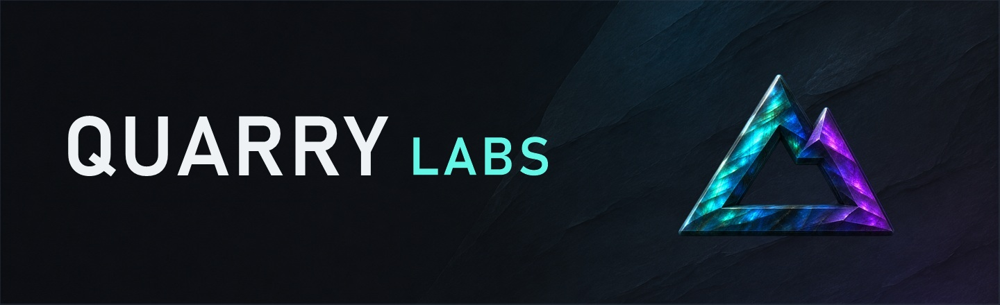
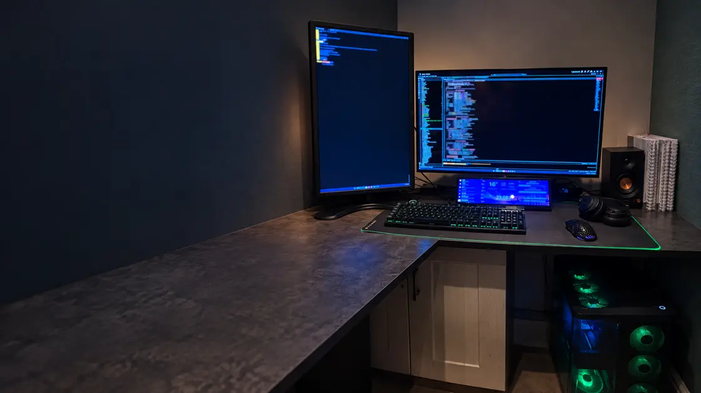
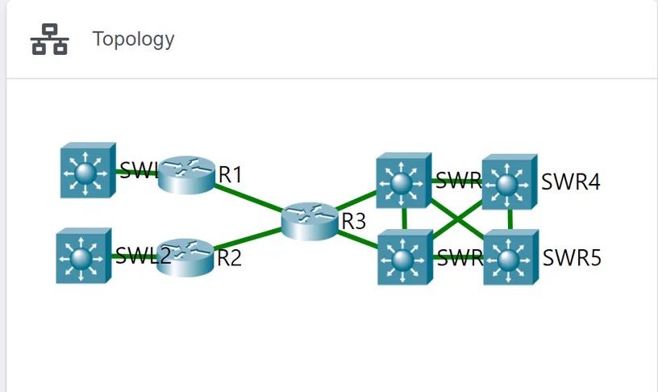
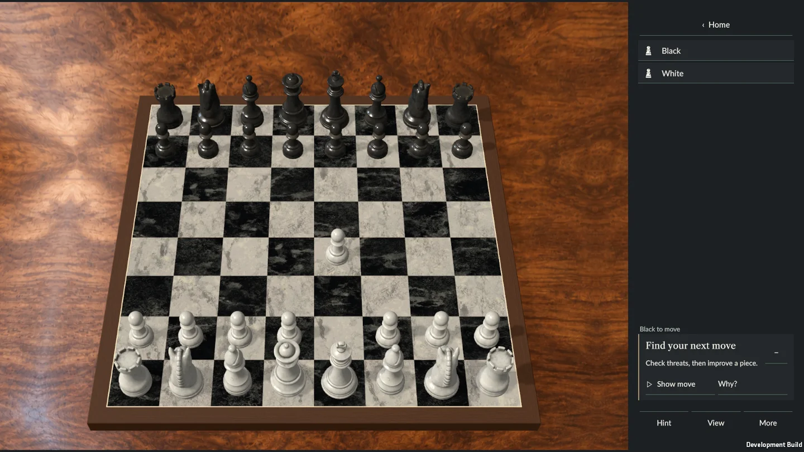

Hands-on networking labs, infrastructure projects, and software experiments.

[Explore the Quarry Labs portfolio](https://www.quarry-labs.com/)

## Featured projects

<table>
  <tr>
    <td width="176"></td>
    <td><strong><a href="https://www.quarry-labs.com/projects/home-lab/">Home Lab</a></strong> Setting up, connecting, and monitoring self-hosted services.</td>
  </tr>
  <tr>
    <td width="176"></td>
    <td><strong><a href="https://www.quarry-labs.com/projects/cisco/">Cisco Networking</a></strong> Practising subnetting, switching, and routing in Cisco Packet Tracer.</td>
  </tr>
  <tr>
    <td width="176"></td>
    <td><strong><a href="https://www.quarry-labs.com/projects/atelier-chess/">Atelier Chess</a></strong> A 3D chess project with crafted boards, multiple camera views, and move analysis.</td>
  </tr>
</table>
